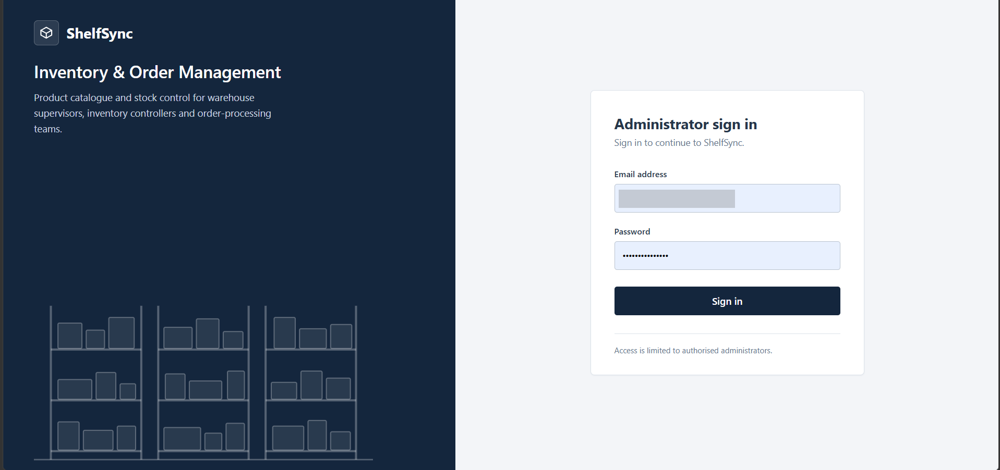
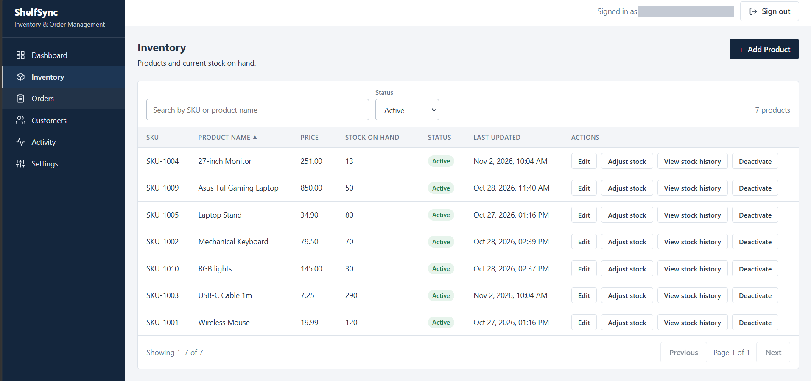
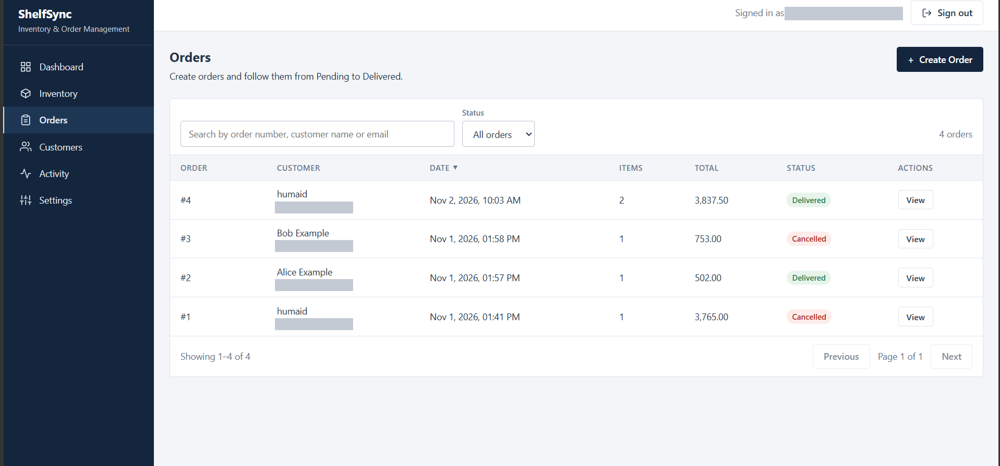
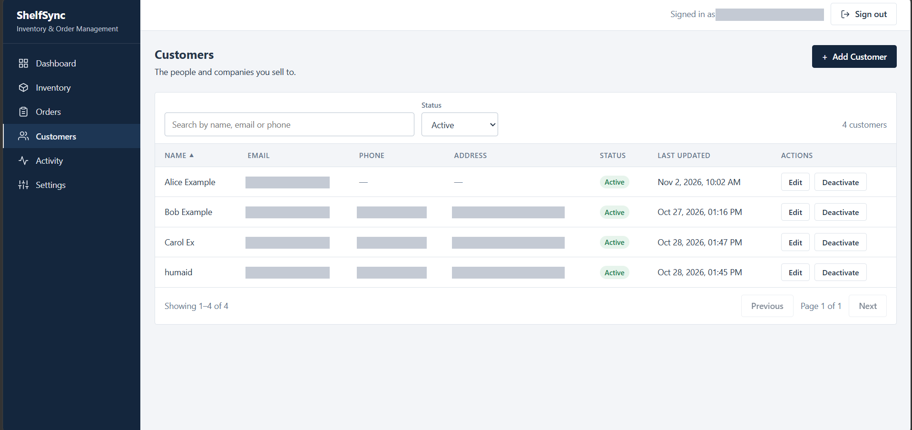
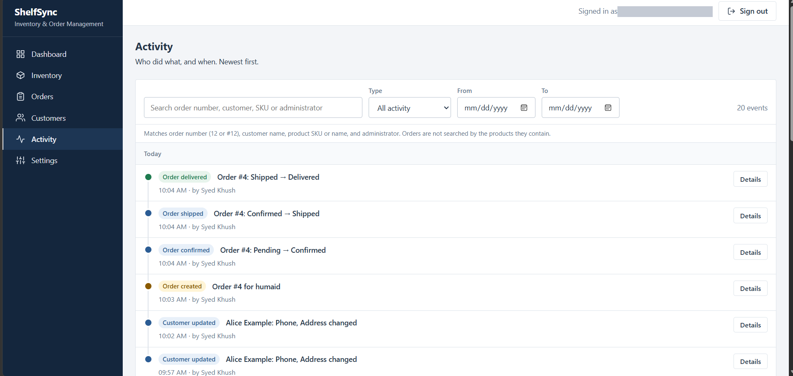
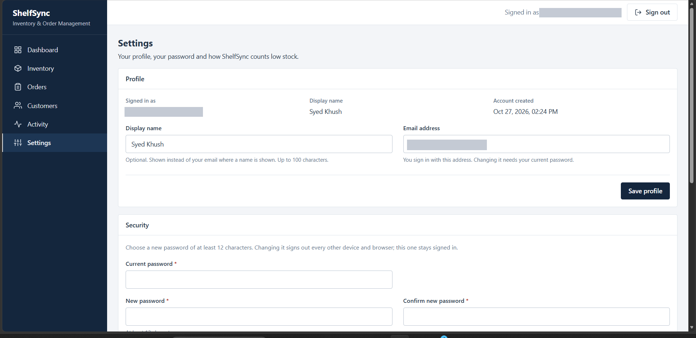
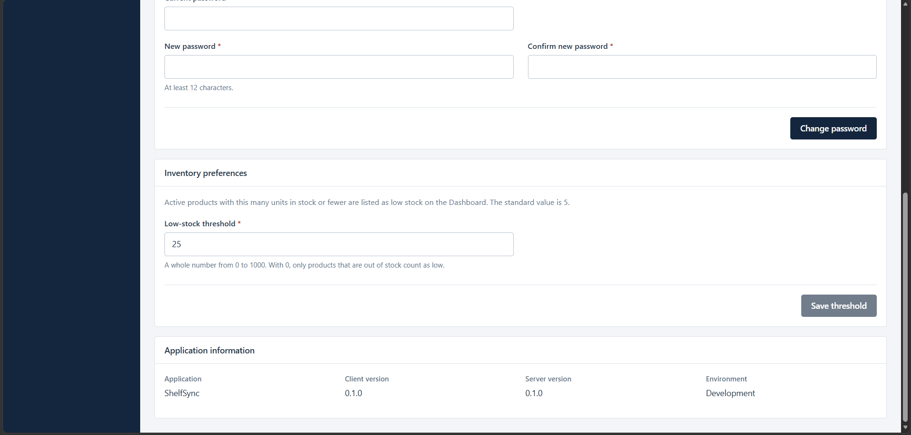

# ShelfSync: Inventory & Order Management

ShelfSync is a full-stack web application for a small business that needs to keep track of **products and stock**,
**customers** and **orders** in one place. A single administrator signs in, manages the catalogue, takes orders through
a controlled lifecycle (pending, confirmed, shipped, delivered or cancelled) and can always see who changed what and when.

It is a portfolio project: it runs locally against MySQL, has no hosted demo, and is written in plain JavaScript
(no TypeScript). The emphasis is on correctness: money is never handled as floating point, stock changes happen inside
database transactions with row locks, and every input is validated on the server.

## Contents
- [Screenshots](#screenshots)
- [Technology stack](#technology-stack)
- [Features](#features)
- [Authentication and account security](#authentication-and-account-security)
- [Order lifecycle and stock movements](#order-lifecycle-and-stock-movements)
- [Audit logging and the Activity page](#audit-logging-and-the-activity-page)
- [Project structure](#project-structure)
- [Getting started](#getting-started)
- [Database setup and migrations](#database-setup-and-migrations)
- [Environment variables](#environment-variables)
- [API reference](#api)
- [Testing](#testing)
- [Known limitations](#known-limitations)
- [Possible future improvements](#possible-future-improvements)

## Screenshots

Click any image to see it full size.

<table>
  <tr>
    <td width="50%" valign="top">
      <a href="docs/ScreenShots/Public/login.png"></a>
      <br><b>Sign in.</b> Administrator sign-in with email and password; access is limited to authorised administrators.
    </td>
    <td width="50%" valign="top">
      <a href="docs/ScreenShots/Public/inventory.png"></a>
      <br><b>Inventory.</b> Searchable, sortable product list with edit, adjust stock, stock history and deactivate actions.
    </td>
  </tr>
  <tr>
    <td width="50%" valign="top">
      <a href="docs/ScreenShots/Public/orders.png"></a>
      <br><b>Orders.</b> Search by order number, customer name or email, filter by status, and open an order to move it through its lifecycle.
    </td>
    <td width="50%" valign="top">
      <a href="docs/ScreenShots/Public/customers.png"></a>
      <br><b>Customers.</b> Customer list with search, status filter, edit, and deactivate or reactivate.
    </td>
  </tr>
  <tr>
    <td width="50%" valign="top">
      <a href="docs/ScreenShots/Public/activity.png"></a>
      <br><b>Activity.</b> Newest-first history of who did what and when, with type and date filters and per-event details.
    </td>
    <td width="50%" valign="top">
      <a href="docs/ScreenShots/Public/settings-profile.png"></a>
      <br><b>Settings: profile and security.</b> Display name and email (changing the email needs the current password), and password change.
    </td>
  </tr>
  <tr>
    <td colspan="2" align="center" valign="top">
      <a href="docs/ScreenShots/Public/settings-preferences.png"></a>
      <br><b>Settings: inventory preferences and application information.</b> The low-stock threshold used by the Dashboard, plus application name, versions and environment.
    </td>
  </tr>
</table>

_The Dashboard and the stock-adjustment form are not pictured yet._

## Technology stack

| Layer | Technology |
|---|---|
| Frontend | React 19, Vite 8, plain CSS; no router or state library (pages use the browser History API) |
| Backend | Node.js, Express 5 |
| Database | MySQL 8 (InnoDB, `utf8mb4`), accessed with `mysql2` and `?` placeholders only |
| Validation | zod |
| Authentication | JSON Web Tokens (`jsonwebtoken`, HS256) in an HttpOnly cookie, passwords hashed with `bcryptjs` |
| Security middleware | `helmet`, `cors` (one allowed origin), `express-rate-limit`, a same-origin (CSRF) check |
| Tests | Jest and supertest (server), Vitest, jsdom and Testing Library (client) |

Exact versions are in `server/package.json` and `client/package.json`.

## Features

All pages require a signed-in administrator. Every page has its own URL (`/`, `/inventory`, `/orders`, `/customers`,
`/activity`, `/settings`), so a refresh keeps you on the same page. Any other path opens the Dashboard, and without a valid
session every URL shows the sign-in page. Search text, filters and page numbers are not stored in the URL, so a refresh
resets them. A production web server must serve `index.html` for these paths (the Vite dev and preview servers already do).

- **Dashboard.** Counts of products and customers, order counts per status, the five most recent orders and a low-stock
  list. Every figure comes from the API; nothing is hard-coded. The low-stock list uses the threshold saved in Settings
  and looks at the active products with the least stock. Each block loads on its own: if one request fails, that block
  shows "Unavailable" with a retry button instead of an invented zero.
- **Inventory.** Product list with search (SKU or name), status filter, sortable columns and pagination. Add and edit
  products (SKU, name, price), deactivate and reactivate (a soft delete; products are never removed), correct stock with a
  required reason, and view a product's stock history.
- **Customers.** List with search (name, email or phone), status filter, sortable columns and pagination. Add, edit,
  deactivate and reactivate (customers are never deleted).
- **Orders.** List with search (customer name, email or order number), status filter, sortable columns and pagination.
  Create an order from active customers and products, open an order's details (lines with the price at the time of
  ordering, totals, status history) and move it forward with Confirm, Ship, Deliver or Cancel as its status allows.
  The create form loads up to 100 active customers and 100 active products and says so when there are more.
- **Activity.** A read-only, newest-first history of what administrators did: order status changes, manual stock
  corrections, and product, customer, account and settings changes. Filter by type and date range, search, and page.
- **Settings.** Edit your display name and email address, change your password, set the low-stock threshold (a whole
  number from 0 to 1000, 5 until you change it), and see application information (name, server and client versions and a
  "development" or "production" label; no secrets or database details).

## Authentication and account security

A short summary. The full description is in [docs/AUTHENTICATION.md](docs/AUTHENTICATION.md).

- Sign in with email and password. The server sets a signed JWT in an **HttpOnly, SameSite=Lax cookie** (`Secure` when
  `NODE_ENV=production`). It lasts one hour and there is no refresh token. The browser never stores the token or password
  in `localStorage` or `sessionStorage`.
- Every protected request re-reads the administrator from the database, so a deactivated account loses access at once.
- Each administrator has a **`token_version`**. A password change raises it, so every older login cookie stops working,
  and the browser that made the change receives a fresh cookie.
- Passwords are hashed with bcrypt (cost 12). New passwords need at least 12 characters; bcrypt's 72-byte limit is enforced.
- Changing the email address or the password requires the **current password**. Wrong guesses are rate limited.
- Failed logins are rate limited per IP address (10 failures per 15 minutes).
- State-changing requests must come from the configured frontend origin (`CLIENT_ORIGIN`); CORS allows only that origin.
- Errors are generic JSON. Stack traces, SQL and secrets are never sent to the browser, and the server log records only short error codes.
- There is no default administrator. You create the first one yourself with `npm run admin:create`.

## Order lifecycle and stock movements

An order is created as `PENDING` and **does not touch stock**. Prices always come from the database, never from the request,
and each line stores the price at the time of ordering, so later price edits never change past orders. Totals are added up in
whole cents.

| Current status | Action | New status | Stock effect |
|---|---|---|---|
| `PENDING` | Confirm | `CONFIRMED` | Deducts every line's quantity |
| `PENDING` | Cancel | `CANCELLED` | None |
| `CONFIRMED` | Ship | `SHIPPED` | None |
| `CONFIRMED` | Cancel | `CANCELLED` | Puts every line's quantity back |
| `SHIPPED` | Deliver | `DELIVERED` | None |
| `DELIVERED`, `CANCELLED` | (none: final statuses) | | |

A shipped order can only be delivered: it cannot be cancelled. Any move not in this table is refused with `409`.

How stock stays correct:
- Each status change runs in **one database transaction**: lock the order row, check the move is allowed from the status the
  order has at that moment, lock the products (lowest id first, so two orders can never wait on each other), change stock,
  save the new status and write an `order_status_history` row. If any step fails, nothing is saved.
- Confirming is refused with `409` and a list of shortages if any product has too little stock. Stock never goes below 0.
- Every stock movement is recorded in `stock_adjustments` with a signed quantity, a reason, the administrator, and a
  `movement_type` of `MANUAL`, `ORDER_CONFIRMED` or `ORDER_CANCELLED`. A unique key on
  `(order_id, product_id, movement_type)` is a second guard against deducting or restoring twice.
- If the database is busy (a lock wait timeout or a deadlock), the API answers `503` with `Retry-After`; nothing was saved
  and trying again is safe.
- Manual stock corrections (Inventory page, "Adjust stock") take a signed change and a required reason, show a preview, lock
  the product row, and refuse a result below 0 or above the column maximum.

## Audit logging and the Activity page

Three records feed the Activity page:

| Source | What it records |
|---|---|
| `order_status_history` | Every order creation and status change, with the administrator |
| `stock_adjustments` (manual rows) | Manual stock corrections; the stock movements caused by orders are shown inside their order event |
| `audit_log` | Product, customer, account and settings changes (added by migration 003) |

`audit_log` is **append-only** (the application only ever inserts) and each row is written in the same transaction as the
change it describes. Its events are `PRODUCT_CREATED`, `PRODUCT_UPDATED`, `PRODUCT_ACTIVATED`, `PRODUCT_DEACTIVATED`,
`CUSTOMER_CREATED`, `CUSTOMER_UPDATED`, `CUSTOMER_ACTIVATED`, `CUSTOMER_DEACTIVATED`, `ACCOUNT_PROFILE_UPDATED`,
`ACCOUNT_PASSWORD_CHANGED` and `SETTINGS_UPDATED`.

**Privacy.** The log never stores text that a person typed. Details are limited by strict schemas to field names, a validated
price (for a product price change, the old and new price) and the low-stock threshold's old and new values. A customer's
name, email, phone and address, a product's SKU and name, passwords, hashes and tokens are never copied into it. The
Activity page shows a product's or customer's *current* name from its own table. History only starts when each record type
was introduced; nothing is back-filled.

## Project structure

- `server/` Express API: `src/` (config, middleware, routes, validation, services, repositories), `tests/`, `scripts/`
  (`create-admin.js`, `db-check.js`) and `database/` (`schema.sql`, `migrations/`, `seed.sql`, `SETUP.md`)
- `client/` React + Vite app: `src/` (pages, components, API helpers, hooks, styles, tests)
- `docs/` Design notes: [docs/AUTHENTICATION.md](docs/AUTHENTICATION.md)

## Getting started

Requirements: Node.js, npm and MySQL 8. The commands below are for Windows PowerShell; other shells work the same
apart from the file-copy command.

1. Install dependencies:
   ```powershell
   cd server; npm install; cd ..\client; npm install; cd ..
   ```
2. Create the databases and the limited `inventory_app` account, and apply the schema. Follow
   [server/database/SETUP.md](server/database/SETUP.md) exactly.
3. Create your local environment files from the examples, then edit them (never commit them):
   ```powershell
   Copy-Item .env.example server\.env
   Copy-Item .env.test.example server\.env.test
   ```
4. Create the first administrator. This writes one row to `inventory_dev` after you confirm; the password is typed at a hidden prompt:
   ```powershell
   cd server; npm run admin:create
   ```
5. Start the two servers in two terminals:
   ```powershell
   cd server; npm run dev      # API on http://localhost:5000
   cd client; npm run dev      # web app on http://localhost:5173
   ```

Open **http://localhost:5173** (not `127.0.0.1`: the API accepts only the exact origin in `CLIENT_ORIGIN`). The Vite dev
server forwards `/api` calls to the API. Leave `NODE_ENV` unset in your terminal (unset means development). The API
refuses to start if it is set to `test` or any value other than `development` or `production`.

Optional sample data (5 products and 3 customers, no administrators) is in `server/database/seed.sql`; see SETUP.md.

## Database setup and migrations

Two databases are used: `inventory_dev` (the app) and `inventory_test` (integration tests only). The schema has **nine tables**:
`admins`, `products`, `customers`, `orders`, `order_items`, `order_status_history`, `stock_adjustments`, `audit_log` and
`app_settings`.

- **New database:** run `server/database/schema.sql` once on an empty database. It already contains everything below.
- **Existing older database:** apply the migrations **in this order, each once**, with the MySQL admin account:

| Migration | File | Adds |
|---|---|---|
| 001 | `001_add_stock_adjustments.sql` | The `stock_adjustments` table |
| 002 | `002_add_order_stock_movements.sql` | `order_id` and `movement_type` columns, a unique key and a foreign key on `stock_adjustments` |
| 003 | `003_add_audit_log_and_settings.sql` | The `audit_log` and `app_settings` tables and `admins.display_name` / `admins.token_version` |

Never run a migration on a database created from the current `schema.sql` (it already has the changes and the script
would stop with an error), and never re-run migration 003 after it partly succeeded; SETUP.md explains the recovery steps.
`npm run db:check` (read-only) reports which migrations a database has. Back up first; SETUP.md has the commands for
backing up and restoring on Windows.

## Environment variables

Names only; put real values in `server/.env` (development) and `server/.env.test` (tests). Both are git-ignored.
The `.example` files in the project root show the layout.

| Variable | Purpose |
|---|---|
| `NODE_ENV` | Leave unset for development; `production` turns on the `Secure` cookie flag. Do not set it to `test` yourself |
| `PORT` | API port (default 5000) |
| `CLIENT_ORIGIN` | The one allowed frontend origin (default `http://localhost:5173`) |
| `DB_HOST`, `DB_PORT`, `DB_NAME`, `DB_USER`, `DB_PASSWORD` | MySQL connection. `DB_NAME` must be `inventory_dev` in `.env` and exactly `inventory_test` in `.env.test` |
| `JWT_SECRET` | At least 32 random characters (the API will not start without a valid one). Use a different value in `.env` and `.env.test`; this is a recommendation, not something the code enforces |
| `VITE_API_BASE_URL` | Client only, optional: the API address if it is not served from the same origin (never put secrets in it) |

## API

All routes are under `/api`. Errors are JSON such as `{ "error": "..." }` and never include SQL or stack traces.
Every route except `POST /api/auth/login` and `POST /api/auth/logout` needs the session cookie
(`401 { "error": "Authentication required" }` without it). Requests that change data must come from the frontend origin
(`CLIENT_ORIGIN`), otherwise `403`. Responses from protected routes are sent with `Cache-Control: no-store`.

**Authentication** (see [docs/AUTHENTICATION.md](docs/AUTHENTICATION.md))
- `POST /api/auth/login` with `{ email, password }` sets the session cookie; `401` with one generic message for an unknown
  email, a wrong password or a deactivated account; `429` after too many failures.
- `POST /api/auth/logout` clears the cookie. `GET /api/auth/me` returns `{ admin: { id, email } }` for a valid session, otherwise `401`.

**Account** (the signed-in administrator's own account; the id always comes from the session, never from the request)
- `GET /api/account` returns `{ account: { id, email, displayName, createdAt } }`.
- `PATCH /api/account/profile` with any of `displayName` (text up to 100 characters, or `null`/`""` to clear), `email` and
  `currentPassword`. Changing the email needs `currentPassword`: `400` if missing, `403` if wrong, `409` if another account
  uses the email. Other properties are rejected. Returns `{ account }`; a change that changes nothing writes nothing.
- `POST /api/account/password` with `{ currentPassword, newPassword }` (at least 12 characters, different from the current
  one). Returns `200` and a **new** session cookie; every other session ends. `403` for a wrong current password.
- Wrong current-password answers (`403`) are limited to 5 per 15 minutes per administrator (`429`). The limit applies to
  `POST /api/account/password`, and to `PATCH /api/account/profile` only when the email address is being changed.

**Settings**
- `GET /api/settings` returns `{ settings: { lowStockThreshold }, app: { name, serverVersion, clientVersion, environment } }`.
- `PATCH /api/settings` with `{ lowStockThreshold }` (a whole JSON number from 0 to 1000). Returns `{ settings }`.
  Saving the value already in force changes and records nothing.

**Activity** (read-only)
- `GET /api/activity` query parameters (all optional; anything invalid returns `400 { "error": "Invalid request", "fields": [...] }`):

| Parameter | Values | Default |
|---|---|---|
| `q` | text up to 100 characters; matches customer name, SKU, product name, the administrator's email or name, and an order number such as `12` or `#12` | empty |
| `type` | `all`, `order`, `stock`, `product`, `customer`, `account`, `settings` | `all` |
| `from`, `to` | UTC instants such as `2026-11-01T00:00:00.000Z`; `from` is inclusive, `to` exclusive, `from` must be earlier | none |
| `page` | whole number from 1 | `1` |
| `pageSize` | whole number 1-100 | `25` |

  Response `200`: `{ items, page, pageSize, total, totalPages }`, newest first. Each item is
  `{ id, type, occurredAt, actor: { id, email, displayName }, entity: { type, id, label }, details }`.

**Products.** Every `/api/products` route needs the session cookie (`401 { "error": "Authentication required" }`
without it). Requests that change data must come from the frontend origin (`CLIENT_ORIGIN`), otherwise `403`.

`GET /api/products` query parameters (all optional; anything invalid returns `400 { "error": "Invalid request", "fields": [...] }`):

| Parameter | Values | Default |
|---|---|---|
| `q` | text, up to 100 characters; matches SKU or name (contains, case-insensitive per the column collation) | empty |
| `status` | `active`, `inactive`, `all` | `active` |
| `page` | whole number from 1 | `1` |
| `pageSize` | whole number 1–100 | `25` |
| `sort` | `sku`, `name`, `price`, `stockQuantity`, `updatedAt` | `name` |
| `order` | `asc`, `desc` | `asc` |

Response `200`: `{ items, page, pageSize, total, totalPages }`. Each item is
`{ id, sku, name, price, stockQuantity, isActive, createdAt, updatedAt }`. `price` is text such as `"19.99"`
(never a floating-point number). Ties in the sort are broken by `id`, so pages are stable. A page past the end
returns an empty `items` list.

`POST /api/products` body, as JSON (up to 10 KB):

| Field | Rule |
|---|---|
| `sku` | required; trimmed; 1–64 characters; ASCII letters, digits and `- _ . /` only (no spaces); letter case is kept |
| `name` | required; trimmed; 1–255 characters; no control characters |
| `price` | required; **text** such as `"19.99"`; up to 8 digits before and 2 after the decimal point; no sign, exponent, comma or currency symbol |
| `stockQuantity` | optional whole number 0–4,294,967,295; omitted (or `""`) means `0` |

Any other property (for example `id`, `isActive`, `createdAt`) is rejected. New products are always active.
Responses: `201 { "product": { ... } }` on success; `400` with `fields` naming each invalid property;
`409 { "error": "A product with this SKU already exists", "fields": ["sku"] }` for a duplicate SKU (the
database's unique key decides, and comparison follows the column collation, `utf8mb4_0900_ai_ci` in the
schema file, which ignores letter case and accents);
`413` if the body is too large.

The routes below use `:id`, a positive whole number (anything else is `400 { "error": "Invalid request", "fields": ["id"] }`).
An id that does not exist returns `404 { "error": "Product not found" }`. They need the session cookie and the
frontend origin like every other write, and they never return SQL or stack traces.

`PATCH /api/products/:id` edits a product. Body: any of `sku`, `name`, `price`, with the same rules as create.
At least one is required, and only the fields sent are changed. `stockQuantity`, `isActive`, `id` and any other
property are rejected with `400` (stock and status have their own routes). Works on inactive products.
Responses: `200 { "product": { ... } }`; `400`; `404`; `409` for a duplicate SKU, as above.
Changing a price does not change past orders: `order_items.unit_price` stores the price at the time of ordering.

`POST /api/products/:id/deactivate` and `POST /api/products/:id/reactivate` set `is_active` to 0 or 1 (no body needed).
Nothing is deleted. Repeating a call is harmless. Response: `200 { "product": { ... } }`.

`POST /api/products/:id/stock-adjustments` corrects stock. Body:

| Field | Rule |
|---|---|
| `delta` | required; a JSON whole number, not 0, between -2,147,483,647 and 2,147,483,647. Positive adds stock, negative removes it |
| `reason` | required; trimmed; 1–255 characters; no control characters |

Any other property (for example `stockQuantity`, `adminId`) is rejected. The administrator recorded in the history
is always the one signed in, never a value from the request. In one database transaction the server locks the product
row, checks the result, updates `stock_quantity` and inserts a `stock_adjustments` row; if any step fails, nothing is saved.
Works on inactive products. Responses: `201 { "product": { ... }, "adjustment": { id, productId, quantityDelta, reason, adminId, createdAt } }`;
`400`; `404`; `409 { "error": "...", "fields": ["delta"], "currentStock": 10 }` when the result would be below 0 or above
4,294,967,295 (nothing is changed).

`GET /api/products/:id/stock-adjustments` returns a product's stock history. It is read-only (nothing is written), needs
the session cookie like every `/api/products` route (`401` without it), and works for inactive products. Query parameters
(optional; anything invalid returns `400 { "error": "Invalid request", "fields": [...] }`):

| Parameter | Values | Default |
|---|---|---|
| `page` | whole number from 1 | `1` |
| `pageSize` | whole number 1–100 | `10` |

Response `200`: `{ items, page, pageSize, total, totalPages }`, newest first (ties broken by id, so pages are stable). Each item is
`{ id, productId, quantityDelta, reason, adminId, createdAt }`. `adminId` is the numeric ID of the administrator who made the
correction; no email or other personal data is returned. A product with no corrections returns `200` with an empty `items`
list and `total` 0; an unknown product returns `404 { "error": "Product not found" }`; an invalid `:id` returns
`400` with `fields: ["id"]`. A page past the end returns an empty `items` list.

**Customers.** Every `/api/customers` route needs the session cookie (`401` without it), and requests that change
data must come from the frontend origin (`403` otherwise), exactly like the product routes. Responses are never cached
(`Cache-Control: no-store`) and never include SQL or stack traces. Customers are never deleted: there is no `DELETE` route,
and the database keeps orders pointing at their customer.

`GET /api/customers` query parameters (all optional; anything invalid returns `400 { "error": "Invalid request", "fields": [...] }`):

| Parameter | Values | Default |
|---|---|---|
| `q` | text, up to 100 characters; matches name, email or phone (contains, case-insensitive per the column collation) | empty |
| `status` | `active`, `inactive`, `all` | `active` |
| `page` | whole number from 1 | `1` |
| `pageSize` | whole number 1–100 | `25` |
| `sort` | `name`, `email`, `createdAt`, `updatedAt` | `name` |
| `order` | `asc`, `desc` | `asc` |

Response `200`: `{ items, page, pageSize, total, totalPages }`. Each item is
`{ id, name, email, phone, address, isActive, createdAt, updatedAt }`; `phone` and `address` are `null` when not set.
Ties in the sort are broken by `id`, so pages are stable.

`POST /api/customers` body, as JSON (up to 10 KB). The limits come from the `customers` table:

| Field | Rule |
|---|---|
| `name` | required; trimmed; 1–255 characters; no control characters |
| `email` | required; trimmed and lower-cased; a valid email address, up to 255 characters; must be unique |
| `phone` | optional; digits and `+ ( ) - .` or spaces only, at least 3 digits, up to 32 characters; `""` or `null` means none |
| `address` | optional; up to 500 characters on one line; `""` or `null` means none |

Any other property (for example `id`, `isActive`) is rejected, and new customers are always active.
Responses: `201 { "customer": { ... } }`; `400` with `fields` naming each invalid property;
`409 { "error": "A customer with this email already exists", "fields": ["email"] }` for a duplicate email
(the database's unique key decides; comparison ignores letter case and accents); `413` if the body is too large.

`PATCH /api/customers/:id` edits a customer: any of `name`, `email`, `phone`, `address` with the rules above (at least
one; only the fields sent are changed; `""` or `null` clears `phone` or `address`). `isActive` and any other property are
rejected with `400`. Works on inactive customers. Responses: `200 { "customer": { ... } }`; `400`; `404`
`{ "error": "Customer not found" }`; `409` for a duplicate email. An invalid `:id` returns `400` with `fields: ["id"]`.

`POST /api/customers/:id/deactivate` and `POST /api/customers/:id/reactivate` set `is_active` to 0 or 1 (no body needed).
Nothing is deleted, and repeating a call is harmless. Response: `200 { "customer": { ... } }` (or `400` / `404` as above).

**Orders.** Create, read and move orders through their statuses (the Orders page uses these routes). The routes
need the session cookie (`401`), writes need the frontend origin (`403`), and responses are never cached. Orders are
never deleted or edited after creation: there is no update or delete route, and the status routes below are the only way
an order changes.

`POST /api/orders` creates a `PENDING` order. Body: `{ "customerId": 3, "items": [{ "productId": 1, "quantity": 2 }] }`.
- 1 to 50 lines; each product at most once; quantity a whole number from 1 to 10000.
- The customer and every product must exist and be active. Unknown ones give `400`, inactive ones `409`
  (with `fields` and, for products, `productIds`).
- Prices, totals and status cannot be sent: any other property is rejected with `400`. The server copies each
  product's current price into the order line (`order_items.unit_price`), so later price edits never change past orders.
- The total is added up in whole cents (never floating point), must fit `DECIMAL(12,2)`, and is returned as a string such as `"64.97"`.
- The order, its lines and its first status record (`null -> PENDING`) are saved together or not at all. Stock is not changed or checked.
- Response `201 { "order": { ... } }` (same shape as the details below).
- Rare case: if the order was saved but reading it back fails, the answer is still `201`, with
  `{ "order": null, "orderId": 12, "status": "PENDING", "totalAmount": "64.97", "detailsAvailable": false, "message": "..." }`.
  The order exists, so do not submit it again; open it from the list. The creation is never retried automatically.

`GET /api/orders` query parameters (all optional; anything invalid returns `400`): `q` (up to 100 characters; matches the
customer's name or email, and also the order number, e.g. `12` or `#12`), `status` (`all`, `PENDING`, `CONFIRMED`,
`SHIPPED`, `DELIVERED`, `CANCELLED`; default `all`), `page` (default 1), `pageSize` (1-100, default 25), `sort` (`id`,
`createdAt`, `updatedAt`, `totalAmount`, `status`, `customerName`; default `createdAt`), `order` (`asc`/`desc`, default `desc`).
Response `200`: `{ items, page, pageSize, total, totalPages }`; each item is
`{ id, status, totalAmount, itemCount, customer: { id, name, email }, createdAt, updatedAt }`. Date filtering is not included yet.

`POST /api/orders/:id/confirm`, `/cancel`, `/ship` and `/deliver` move an order to its next status (no body needed).
Each one runs in a single database transaction that locks the order row, checks the move is allowed from the status the
order has at that moment, changes stock if needed, saves the new status and writes an `order_status_history` row
(`fromStatus -> toStatus`, with the administrator). If any step fails, nothing is saved.

| Current status | Allowed next | Stock effect |
|---|---|---|
| `PENDING` | `confirm` -> `CONFIRMED` | deducts every line's quantity |
| `PENDING` | `cancel` -> `CANCELLED` | none |
| `CONFIRMED` | `ship` -> `SHIPPED` | none |
| `CONFIRMED` | `cancel` -> `CANCELLED` | puts every line's quantity back |
| `SHIPPED` | `deliver` -> `DELIVERED` | none |
| `DELIVERED`, `CANCELLED` | nothing (final statuses) | none |

A `SHIPPED` order can only be delivered: it cannot be cancelled. A `DELIVERED` order cannot be changed or cancelled.

- **Confirm** locks the order, then the products in ascending id order, and checks that every product has enough stock.
  If any product is short, the whole confirmation is refused with `409 { "error": "Not enough stock to confirm this order",
  "shortages": [{ "productId", "requested", "available" }] }` and nothing changes; the order stays `PENDING`. Stock never goes
  below 0. Products deactivated since the order was placed can still be confirmed. Each deduction is also recorded in
  `stock_adjustments` (negative change, `movement_type` `ORDER_CONFIRMED`, `order_id`, reason `Order #12 confirmed`), so it
  appears in the product's stock history.
- **Cancelling a `CONFIRMED` order** adds the quantities back (movement `ORDER_CANCELLED`, positive change, reason
  `Order #12 cancelled`). It happens once: the status leaves `CONFIRMED` in the same transaction, so a repeat is refused,
  and the unique key on `stock_adjustments (order_id, product_id, movement_type)` is a second guard. If a restore would pass
  the largest stock quantity (4294967295) it is refused with `409` and `productIds`.
- **Not allowed or repeated** (confirming twice, cancelling a cancelled or shipped order, shipping a `PENDING` order, ...)
  returns `409 { "error": "This order is already CONFIRMED", "currentStatus": "CONFIRMED" }` (the message says "already" when
  the order has that status, otherwise "is X and cannot be changed to Y") and changes nothing.
- Unknown id `404`; invalid id `400`. Success is `200 { "order": { ... } }` in the details shape below.
- Busy order: if another request holds a lock on the order or one of its products for too long (MySQL
  `ER_LOCK_WAIT_TIMEOUT`), or MySQL ends the request to break a deadlock (`ER_LOCK_DEADLOCK`), the answer is
  `503 { "error": "The order is busy; please try again." }` with a `Retry-After: 2` header. The transaction was rolled
  back, so nothing was saved and trying again is safe. Only these two database errors are treated this way, and only on
  these four status routes; any other database error is the generic `500`.
- Rare case, as for creation: if the change was saved but the order cannot be read back, the answer is still `200` with
  `{ "order": null, "orderId", "status", "detailsAvailable": false, "message" }`. Do not repeat the action; a repeat would be
  refused anyway.

`GET /api/orders/:id` returns `200 { "order": { id, status, totalAmount, customer: { id, name, email, isActive },
items: [{ id, productId, sku, productName, quantity, unitPrice, lineTotal }], statusHistory: [{ id, fromStatus, toStatus,
changedByAdminId, changedAt }], createdAt, updatedAt } }`. `unitPrice` is the price saved when the order was placed.
Unknown id: `404 { "error": "Order not found" }`; invalid id: `400`.

## Testing

Run these from `server/` or `client/`. **Know which commands write to a database before you run them.**

| Command | What it does | Database effect |
|---|---|---|
| `server`: `npm test` or `npm run test:unit` | Server unit tests with mocks | None. The MySQL driver is replaced by a fake that refuses to connect, so a unit test cannot reach any database. |
| `server`: `npm run test:integration` | Integration tests against real MySQL: authentication and sessions, accounts and passwords, settings, orders, stock, activity, audit-log privacy and concurrent requests | **WRITES.** Empties all nine tables of `inventory_test` before every test and after the run, and creates its own test data (administrators, customers, products, orders). It refuses to run unless the configured and the live database are exactly `inventory_test`, and its helpers send only `SELECT`, `INSERT` and `UPDATE` statements that never name a database. It never targets `inventory_dev`. |
| `server`: `npm run db:check` / `npm run db:check:test` | Checks tables, columns, indexes and foreign keys, and which migrations are applied | Read-only (`inventory_dev` / `inventory_test`). |
| `server`: `npm run admin:create` | Creates the administrator | **WRITES** one row to `inventory_dev` after a typed confirmation. |
| `client`: `npm test` | Component and API tests with a fake `fetch` | None, and no server is needed. |
| `client`: `npm run build` | Production build into `client/dist` | None. |

Before the integration tests can run, `inventory_test` must have the full schema (all of migrations 001-003, or a fresh
`schema.sql`); see [server/database/SETUP.md](server/database/SETUP.md). `npm test` deliberately skips `tests/integration/`.
Do not reorder the flags of the `test:integration` script: the path must come first. Do not set `NODE_ENV` yourself; Jest
does it.

The unit tests cover validation, services, repositories (with mocked database access), middleware, rate limiting, the audit
allowlists, the pages and the components. The integration tests (`server/tests/integration/`) run the real routes against the
real test database and cover the order lifecycle and stock movements, manual stock corrections, the Activity feed, the audit
log and its privacy rules, settings, account changes, password changes and session invalidation, every protected route, the
same-origin check, both rate limiters, and several requests racing for the same rows. Shared helpers are in
`server/tests/helpers/`. The client is covered by unit tests only; there are no browser end-to-end tests. This README does not
record test results; run the commands above.

## Known limitations

- **One role.** Every administrator can do everything; there are no roles or per-user permissions, and no self-service
  sign-up or password reset by email (the first administrator is created from the command line).
- **Sessions.** One-hour sessions with no refresh token. Logging out clears the browser's cookie but does not revoke the
  token; only a password change (or deactivating the account) ends other sessions before the hour is up.
- **Rate limiting** is held in memory per server process, so it resets when the server restarts and is not shared between
  several instances. If the API runs behind a reverse proxy, Express's `trust proxy` setting is not configured yet, so the
  per-IP login limit would see the proxy's address.
- **Not deployment-ready as shipped.** There is no Dockerfile, hosting guide, health-check route or graceful shutdown. The
  API does not serve the built client. The login cookie is `SameSite=Lax`, so the client and the API need to be served from
  the same site (for example behind one reverse proxy).
- **Orders** cannot be edited after creation (only moved through statuses), have no date filter, and one order has at most
  50 lines. There are no invoices, payments, shipping details, returns or partial shipments.
- **Single currency**, no tax handling; prices have two decimals.
- **Activity history** only goes back to when each record type was introduced, and audit entries for SKU, name and contact
  details deliberately record only that a field changed.
- **Test coverage.** The integration tests need a migrated `inventory_test` database and are run by hand: there is no CI
  workflow and no end-to-end browser test. Two paths are covered by unit tests only, because they cannot be triggered
  reliably against a real database: the `503` "busy" answer (it needs MySQL's 50-second lock-wait timeout) and an order that
  was saved but could not be read back.
- **Dashboard** figures come from several list requests rather than one summary endpoint.
- **No screenshots, demo or license file yet.**

## Possible future improvements

- Run the integration tests automatically in CI against a throw-away MySQL service
- A separate test-only database account, so the database itself (not only the code) keeps tests away from `inventory_dev`
- "Sign out everywhere", a general API rate limit and a shared rate-limit store
- `trust proxy` configuration, a health route, graceful shutdown and a deployment guide
- A summary endpoint for the Dashboard, a date filter for orders and CSV export
- Roles and multiple administrators, password reset, and a top-level error boundary in the client
- A continuous-integration workflow for the unit tests and the client build
